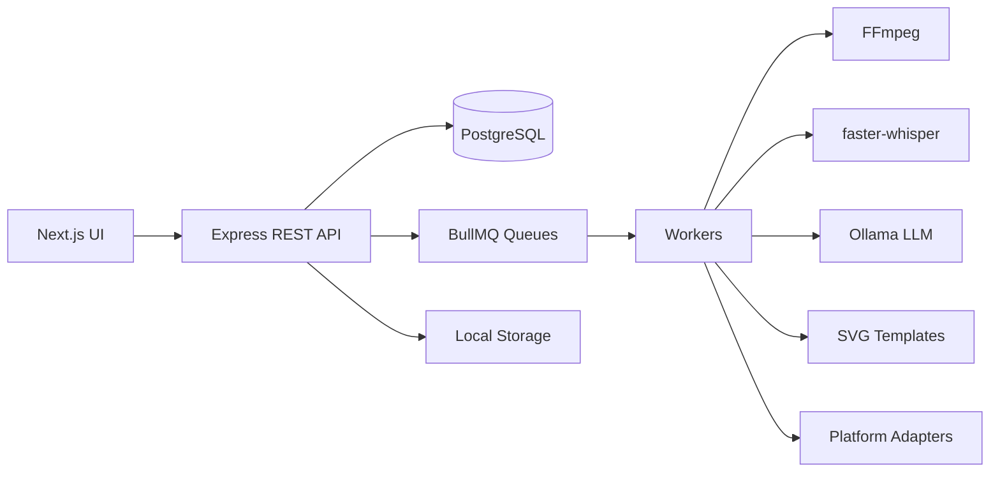

# ContentFlow AI — Architecture

## Overview

ContentFlow AI is a monorepo with a **Next.js** frontend and **Express + TypeScript** backend. Long-running work (transcription, LLM, image render, publish) runs in **BullMQ** workers backed by **Redis**. Persistent state lives in **PostgreSQL** via **Prisma**. Media files are stored on disk; the database stores paths and metadata only.

## Data flow

## Pipeline stages

1. **Upload** — multipart stream to disk; `MediaAsset` + `Project` created.
2. **Transcribe** — FFmpeg extracts audio; Python `faster-whisper` produces segments.
3. **Moments** — Ollama returns JSON ranking ~10 moments from transcript chunks.
4. **Posts** — Ollama generates 12–15 platform-specific drafts linked to moments.
5. **Graphics** — deterministic SVG/HTML → PNG via sharp (optional).
6. **Review** — user edits, approves/rejects; history logged.
7. **Schedule** — `ScheduledPost` enqueued with timezone; idempotent publish jobs.
8. **Publish** — adapter per platform; success only when API confirms.

## Workspace isolation

All projects and assets belong to a **Workspace**. Users access data through **WorkspaceMembership** roles (`OWNER`, `ADMIN`, `MEMBER`).

## Security

- Passwords: bcrypt
- Sessions: HTTP-only JWT cookie
- Social tokens: encrypted at rest with `TOKEN_ENCRYPTION_KEY`
- Upload validation: MIME + extension + size cap
- Rate limiting on auth and upload routes

## Hardware notes

| Component | Minimum | Recommended |
|-----------|---------|-------------|
| CPU | 4 cores | 8+ cores |
| RAM | 8 GB | 16 GB+ |
| Disk | 10 GB free | SSD with space for media |
| GPU | Optional | Speeds Whisper/Ollama |

Whisper `base` on CPU is usable for short clips; use `small` or GPU for long podcasts.
